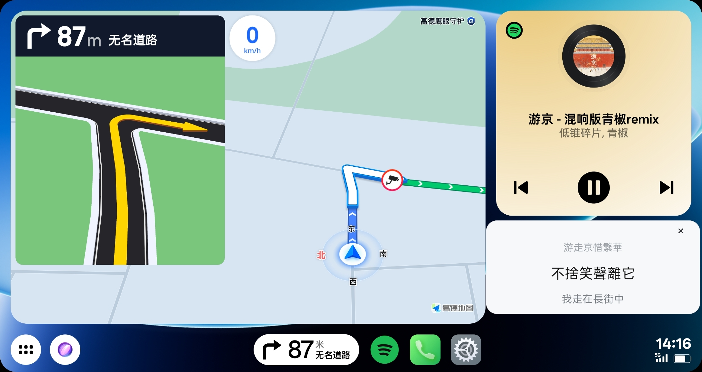

# Spotify 悬浮歌词 for Car+

在 Android / OPPO Car+ 车联界面上，为 Spotify 显示同步歌词的轻量悬浮窗。应用只读取 Spotify 的媒体状态与播放进度，不创建或争抢媒体会话，因此不会主动控制、暂停或恢复 Spotify。通知监听服务不可用时，会自动通过 Spotify MediaSession 继续读取播放状态。

它不是 Car+ 专属协议插件。理论上，运行 Android 8.0 或更高版本、能够授予通知使用权和悬浮窗权限，并且 Spotify 可以正常显示媒体通知的 Android 手机或设备，均可在手机端尝试使用。能否把歌词显示到车机上，还取决于车联系统是否会转发 Android 系统悬浮窗。

目前仅在 OPPO 手机与 Car+ 车联环境中实际验证；其他品牌手机、Android 设备、车型和车机投屏方案请自行测试，不保证兼容。CarPlay、Android Auto 官方界面和不转发悬浮窗的封闭车联系统通常无法使用。



## 功能

- 无需 Root
- 读取 Spotify 当前歌曲、播放状态和进度，通知监听不可用时自动改用 MediaSession
- 歌词来源依次为：网易云音乐、QQ 音乐、LRCLIB
- 优先显示中文歌词，支持简体中文 / 繁體中文即时切换（默认繁体）
- 外语歌曲在歌词源提供逐行翻译时显示中文翻译，翻译会跟随简体 / 繁体设置
- 固定尺寸悬浮窗，避免歌词长度变化导致窗口遮挡播放按钮
- 自动跟随系统亮色 / 暗色模式，也可在应用内手动切换
- 不在悬浮窗重复显示歌名和歌手
- 设置页支持滚动，并可一键复制不含账号、歌名和歌词正文的诊断日志

## 安装与使用

1. 从本仓库的 Releases 下载 APK 并安装。
2. 打开“Spotify 悬浮歌词”。
3. 授予“通知使用权”和“显示在其他应用上层”权限。
4. 启动歌词服务，再打开 Spotify 播放歌曲。
5. 进入 Car+ 车联界面后，拖动歌词窗到合适位置。

可在应用主页通过“中文歌词”按钮切换简体或繁体，当前歌词会立即变化，无需重新搜索或重启服务。

外语歌曲的当前歌词会在原文下方显示逐行中文翻译；上一行和下一行仍只显示原文，以保持悬浮窗尺寸不变。翻译由歌词源提供，没有翻译的数据只显示原文。

如遇到“等待 Spotify”或连接异常，可点击“重新连接 Spotify”；仍无法恢复时，点击“复制诊断日志”并将内容提交到 Issue。诊断日志不记录 Spotify 账号、歌名、歌手、歌词正文或完整播放历史。

应用需要网络连接来查询歌词。首次匹配某首歌时可能会有短暂延迟。

> 使用前请阅读 [使用须知](NOTICE.md)。驾驶过程中请勿操作手机或调试应用；请在安全停车后完成安装、授权和设置。

## 权限说明

- `通知使用权`：读取 Spotify 媒体通知中的歌曲信息、播放状态与进度。
- `悬浮窗`：在 Car+ 车联界面上显示歌词。
- `网络访问`：从歌词服务查询歌词。
- `前台服务 / 通知`：让歌词服务在后台持续运行。

应用不会申请 Root，不会读取 Spotify 账号密码，也不会上传用户的播放历史。

## 从源码构建

要求：JDK 17、Android SDK 35。

```bash
./gradlew assembleDebug
```

生成文件位于 `app/build/outputs/apk/debug/`。

## 已知限制

- 手机端理论要求为 Android 8.0 或更高版本，并能授予通知使用权、悬浮窗权限及网络访问权限；部分系统的后台限制可能影响持续运行。
- 目前仅在 OPPO 手机与 Car+ 车联场景中实际验证，其他品牌手机、Android 设备、车型或车机投屏环境请自行测试，不保证兼容。
- 能否显示取决于车联系统是否转发 Android 系统悬浮窗；“手机能运行”不代表“车机界面一定能显示”。
- 应用包名为 `cmccwm.mobilemusic`，用于适配 Car+ 的音乐应用识别；它可能与使用相同包名的应用冲突。
- 网易云音乐和 QQ 音乐歌词接口并非官方公开 API，服务端变更后可能失效；届时会自动尝试 LRCLIB。
- 歌词匹配依赖歌名、歌手和时长；混音版、现场版或同名歌曲可能匹配不到或匹配错误。
- 中文翻译取决于歌词源是否提供逐行翻译；LRCLIB 通常仅提供原文，因此并非所有外语歌曲都有翻译。

## 歌词与版权

本项目只提供歌词检索和显示功能，不随源码分发歌词内容。歌词版权归原作者及相应权利人所有。请遵守所在地法律和各服务的使用条款。

Spotify、QQ 音乐、网易云音乐及其名称、图标和商标归各自权利人所有。本项目是非官方的社区项目，与上述平台及 OPPO 没有隶属、授权或合作关系。

## Star History

[](https://star-history.com/#Phinsin666/CarLyrics&Date)

## 支持项目

本项目完全开源免费。如果它对你有帮助，可以为项目点一个 Star；也可以自愿请作者喝杯咖啡。赞赏不构成购买、订阅或服务承诺。

<table>
  <tr>
    <th>支付宝</th>
    <th>微信支付</th>
  </tr>
  <tr>
    <td></td>
    <td></td>
  </tr>
</table>

## 许可证

源代码以 [MIT License](LICENSE) 开源。

